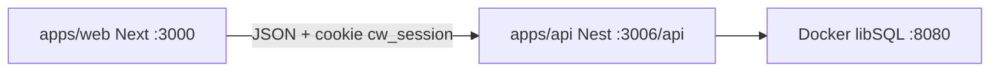

# Arquitectura

Monorepo Bun + Turborepo: Next.js habla con NestJS por HTTP y cookie JWT. Solo la base de datos corre en Docker.



## Apps

| Pieza | Stack | Puerto |
|-------|-------|--------|
| `apps/web` | Next.js 16 App Router, React 19, Tailwind v4, TanStack Query, xyflow | 3000 |
| `apps/api` | NestJS 12, Prisma 6 + adapter libSQL, Zod, argon2, JWT | 3006 |
| `packages/ui` | Componentes compartidos (mínimos) | — |
| `docker-compose.yml` | `ghcr.io/tursodatabase/libsql-server` | 8080 |

El frontend llama a `/api` en el mismo origen (`localhost:3000`). Next reescribe esas rutas hacia Nest en `:3006`, así la cookie de sesión es de primer partido.

## Auth

- Login `POST /api/auth/login` con email y contraseña.
- JWT en cookie httpOnly `cw_session` (7 días, SameSite=Lax).
- `GET /api/auth/me` devuelve perfil, áreas que lidera y membresías (`canAssign`, `canClose`).
- Guard global JWT; `GET /api/health` y login son públicos.

No hay portal de clientes ni SAML en esta versión.

## Datos

Prisma en `apps/api/prisma/schema.prisma`. En runtime Nest usa el adapter libSQL (`LIBSQL_URL`). El `DATABASE_URL` de Prisma es un archivo placeholder solo para generar el cliente.

Tablas principales:

- `User` — `ADMIN`, `MANAGEMENT` (Gerencia), `AREA_LEAD` (Jefe de área) o `EMPLOYEE` (Empleado)
- `Area` — árbol (`parentId`) + `leadUserId`
- `AreaMembership` — `canAssign`, `canClose`
- `Ticket` — destino, asignado, estado, prioridad
- `TicketComment` / `TicketEvent` — hilo y auditoría
- `Notification` — campana in-app
- `TicketCounter` — correlativo `CW-####`

El esquema inicial está en `apps/api/prisma/init.sql`. El seed vive en `apps/api/prisma/seed.ts`.

## API (prefijo `/api`)

| Recurso | Acciones |
|---------|----------|
| `/auth` | login, logout, me |
| `/users` | listar; crear/editar (Admin) |
| `/org/tree` | organigrama |
| `/org/areas` | CRUD de áreas (Admin); miembros (Admin o lead) |
| `/tickets` | listar, KPIs, crear, detalle, asignar, estado, comentarios |
| `/notifications` | listar, marcar leídas |

Permisos de ticket se evalúan en el servicio, no solo por rol global:

- Crear: autenticado
- Ver: requester, assignee, miembros/lead del área, Admin, Gerencia
- Asignar: Admin, Gerencia, lead, o `canAssign`
- Cerrar: Admin, Gerencia, lead, o `canClose`

## Variables

API (`apps/api/.env`):

```
DATABASE_URL="file:./prisma/placeholder.db"
LIBSQL_URL="http://127.0.0.1:8080"
JWT_SECRET="dev-castlewalk-secret-change-me"
CORS_ORIGIN="http://localhost:3000"
PORT=3006
COOKIE_NAME="cw_session"
```

Web (`apps/web/.env.local`):

```
NEXT_PUBLIC_API_URL=/api
API_PROXY_TARGET=http://localhost:3006
```

Los `.env` reales no se suben al repo. Usa los `.env.example`.

## Fuera de alcance

Correo, SAML/Azure AD, adjuntos en S3 y portal para clientes externos.

## Next step

Para arrancar en local, [getting-started.md](getting-started.md).
