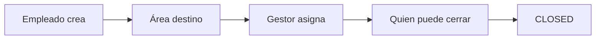

# Cómo usar el sistema de tickets

Los empleados dejan de pedir cosas por correo. Cada solicitud va a un área (HR, TI, nómina, etc.). El gestor de esa área asigna y controla quién puede cerrar.

## Roles

| Quién | Qué puede hacer |
|-------|-----------------|
| **Admin** | Ve y configura todo: usuarios, áreas, tickets, organigrama |
| **Gestor / gerente de área** | Asigna tickets de su área, otorga `canAssign` / `canClose`, puede cerrar |
| **Empleado** | Crea tickets hacia cualquier área y trabaja los que le asignan |

`AREA_LEAD` no es un rol global. Quien figura como *lead* de un área (gerente o gestor) obtiene esos permisos en esa área.

## Flujo de un ticket

1. Cualquier usuario autenticado crea un ticket y elige el área.
2. El gestor ve el inbox de su área y asigna a alguien del equipo.
3. El asignado mueve el estado (`OPEN` → `IN_PROGRESS` → `WAITING` → `RESOLVED`).
4. Solo Admin, el lead del área o un miembro con `canClose` puede pasar a `CLOSED` o `CANCELLED`.

Prioridades: `LOW`, `MEDIUM`, `HIGH`, `URGENT`. El número se genera como `CW-0001`, `CW-0002`, …

## Recorrido recomendado (demo)

1. Entra como `martin.employee@castlewalk.us` y crea un ticket hacia **Human Resources**.
2. Cierra sesión. Martín no puede cerrar ese ticket.
3. Entra como `sofia.hr@castlewalk.us` y asígnalo a Lucía.
4. Entra como `lucia.hr@castlewalk.us` y ciérralo.
5. Entra como admin y abre **Organization** para ver el árbol de áreas.

## Pantallas

| Ruta | Quién | Para qué |
|------|-------|----------|
| `/login` | Todos | Email + contraseña |
| `/` | Autenticados | KPIs: abiertos, vencidos, míos, por área |
| `/tickets` | Autenticados | Lista, tablero, filtros |
| `/tickets/new` | Autenticados | Nueva solicitud |
| `/tickets/[id]` | Quienes pueden verlo | Hilo, actividad, asignar, cerrar |
| `/org` | Autenticados | Organigrama. Admin crea áreas; lead gestiona miembros |
| `/admin/users` | Admin | Alta de empleados |
| `/admin/areas` | Admin | Listado y alta de áreas |

La UI replica CastleWalk (OnboardingClient): sidebar navy `#0C1044`, header naranja `#C96908`, canvas `#F3F4F6`. El idioma se cambia EN/ES en el header.

## Organigrama y áreas

Áreas semilla bajo **CastleWalk**:

- General gerence
- Payroll
- Onboarding
- Human Resources
- Support and TI
- Development
- Design
- Marketing
- Contability
- Finance

Puedes crear más áreas y subáreas. Un área no se elimina si todavía tiene tickets o hijas.

En cada área, el gestor marca por miembro:

- **Can assign** — puede asignar tickets
- **Can close** — puede cerrar o cancelar

## Quién ve cada ticket

Lo ve Admin, el solicitante, el asignado, el lead del área y los miembros de esa área.

## Next step

Si necesitas endpoints o el modelo de datos, ve a [architecture.md](architecture.md).
