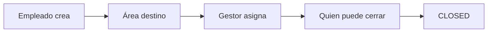

# Cómo usar el sistema de tickets

Los empleados dejan de pedir cosas por correo. Cada solicitud va a un área (HR, TI, nómina, etc.). El gestor de esa área asigna y controla quién puede cerrar.

## Roles

| Quién              | Qué puede hacer                                                                 |
| ------------------ | ------------------------------------------------------------------------------- |
| **Admin**          | Ve y configura todo: usuarios, áreas, tickets, organigrama                      |
| **Gerencia**       | Ve todos los tickets, puede asignar y cerrar en cualquier área. No administra usuarios ni áreas |
| **Jefe de área**   | Asigna tickets de su área, otorga `canAssign` / `canClose`, puede cerrar        |
| **Empleado**       | Crea tickets hacia cualquier área y trabaja los que le asignan                  |

El jefe de un área se asigna en el organigrama (`leadUserId`). El rol **Jefe de área** es el cargo; los permisos de esa área siguen dependiendo de figurar como lead.

## Flujo de un ticket

1. Cualquier usuario autenticado crea un ticket y elige el área.
2. El gestor ve el inbox de su área y asigna a alguien del equipo.
3. El asignado mueve el estado (`OPEN` → `IN_PROGRESS` → `WAITING` → `RESOLVED`).
4. Solo Admin, Gerencia, el jefe del área o un miembro con `canClose` puede pasar a `CLOSED` o `CANCELLED`.

Prioridades: `LOW`, `MEDIUM`, `HIGH`, `URGENT`. El número se genera como `CW-0001`, `CW-0002`, …

## Recorrido recomendado (demo)

1. Entra como `martin.employee@castlewalk.us` y crea un ticket hacia **Human Resources**.
2. Cierra sesión. Martín no puede cerrar ese ticket.
3. Entra como `sofia.hr@castlewalk.us` y asígnalo a Lucía.
4. Entra como `lucia.hr@castlewalk.us` y ciérralo.
5. Entra como admin y abre **Organization** para ver el árbol de áreas.

## Pantallas

| Ruta            | Quién                | Para qué                                              |
| --------------- | -------------------- | ----------------------------------------------------- |
| `/login`        | Todos                | Email + contraseña                                    |
| `/`             | Autenticados         | KPIs: abiertos, vencidos, míos, por área              |
| `/tickets`      | Autenticados         | Lista, tablero, filtros                               |
| `/tickets/new`  | Autenticados         | Nueva solicitud                                       |
| `/tickets/[id]` | Quienes pueden verlo | Hilo, actividad, asignar, cerrar                      |
| `/audit`        | Autenticados         | Tiempos y responsables de los tickets que pueden ver  |
| `/org`          | Autenticados         | Organigrama. Admin crea áreas; lead gestiona miembros |
| `/admin/users`  | Admin                | Alta de empleados                                     |
| `/admin/areas`  | Admin                | Listado y alta de áreas                               |

La UI replica CastleWalk (OnboardingClient): sidebar navy `#0C1044`, header naranja `#C96908`, canvas `#F3F4F6`. El idioma se cambia EN/ES en el header.

## Organigrama y áreas

Áreas semilla bajo **CastleWalk**:

- General gerence
- Payroll
- Onboarding
- Human Resources
- Support and TI
- Development
- Design
- Marketing
- Contability
- Finance

Puedes crear más áreas y subáreas. Un área no se elimina si todavía tiene tickets o hijas.

En cada área, el gestor marca por miembro:

- **Can assign** — puede asignar tickets
- **Can close** — puede cerrar o cancelar

## Quién ve cada ticket

Lo ve Admin, Gerencia, el solicitante, el asignado, el jefe del área y los miembros de esa área.

## Ticket audit

Open **Audit / Auditoría** in the sidebar to see elapsed calendar time from ticket
creation to the first recorded detail view, first transition to `IN_PROGRESS`,
and first transition to `RESOLVED`. Each ticket shows the person and timestamp
for its first milestone. `OPEN` means the ticket was created; it does not mean
someone started handling it. Reopening a ticket does not reset these milestones.

The person table averages each person's first action per ticket and shows the
sample count for each milestone. Another person's later first view contributes
to their own average, while the ticket row retains its earliest view. These
durations include nights and weekends; they do not measure active working time.

Views start being recorded with this feature, after the detail is displayed in
a visible browser tab. Prefetching and list views do not count. Repeated views
and retries preserve the first server timestamp per person and ticket. If
recording fails, the detail shows a retry action. Missing historical evidence is
shown as unavailable and excluded from averages; old status-change events remain
usable. The audit screen applies the same ticket visibility rules as the list.

The API exposes authenticated `POST /tickets/:id/read` and `GET /tickets/audit`.
The report includes all currently visible tickets. The new `READ` event uses the
existing SQLite `TicketEvent` table; regenerate the Prisma client when updating
the application. No database reset or migration is required.

## Next step

Si necesitas endpoints o el modelo de datos, ve a [architecture.md](architecture.md).
